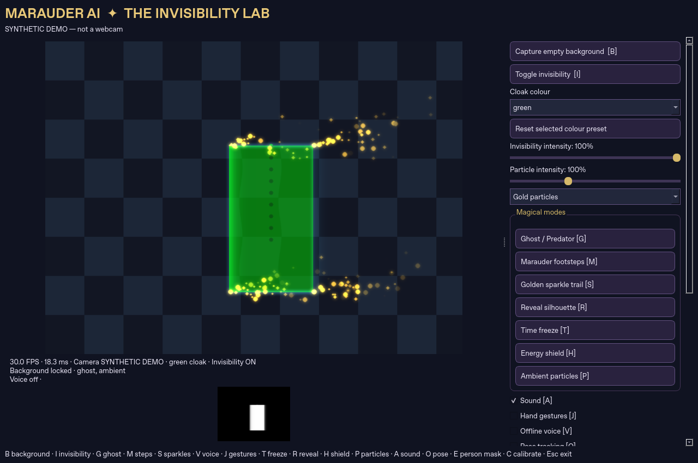
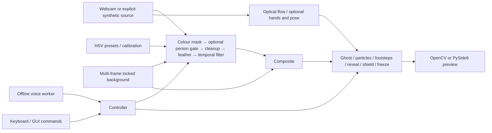

# MARAUDER AI — The Intelligent Magical Invisibility System

A real-time Python computer-vision illusion inspired by Harry Potter's cloak.
A **fixed camera** records an empty scene, then HSV colour segmentation replaces
matching cloth pixels with that saved background. It is not physical
invisibility: uncovered skin and clothing remain visible.



## Features

- Webcam discovery, requested resolution, FPS and processing-time monitoring.
- Multi-frame median background capture, recapture, locking and conservative
  warnings when substantial visible background changes persist.
- Green, red (wrapped hue) and blue keys; live HSV calibration and JSON save/load.
- Morphological cleanup, contour filtering, feathered edges and time-aware smoothing.
- Ghost/Predator transparency, cyan shimmer, motion-driven golden sparkle trail.
- Measured-motion footsteps using optical flow with silhouette-motion fallback;
  optional four-point floor homography.
- Offline Vosk commands, MediaPipe open-palm/fist controls and synthesized chimes.
- Ambient gold/purple/blue particles, pulsing reveal/heatmap, output freeze,
  animated shield, optional pose anchoring and person-mask refinement.
- Dark PySide6 desktop with live output/mask, camera/status/mode indicators,
  calibration, mode controls and invisibility/particle intensity sliders.
- Lightweight OpenCV interface, explicit synthetic demo, headless video recorder,
  automated tests and profiling tools.

All six implementation phases are represented in separate commits. Automated
software validation is complete for the checks below; **physical webcam, cloth,
hands, speech, microphone and speaker acceptance is still outstanding** in this
camera-less cloud environment. See [validation](docs/validation.md).

## Installation

Use **Python 3.11 or 3.12** (3.12 validated here). The pinned MediaPipe/NumPy
combination is not intended for newer Python versions. Use a fresh environment:

```bash
cd MARAUDER-AI
python -m venv .venv
source .venv/bin/activate
# Windows PowerShell instead: .venv\Scripts\Activate.ps1
python -m pip install -r requirements-gui.txt
python main.py --gui --width 640 --height 480
```

Installation choices:

| File | What it installs |
| --- | --- |
| `requirements.txt` | NumPy 1.26.4 and OpenCV contrib 4.11.0.86; lightweight core/effects |
| `requirements-interaction.txt` | Core + MediaPipe 0.10.21, Vosk 0.3.45, sounddevice 0.5.1, Pygame 2.6.1 |
| `requirements-gui.txt` | Interaction stack + PySide6 6.8.3 |
| `requirements-dev.txt` | Core + pytest 8.4.2 and Ruff 0.11.13 |
| `requirements-lock.txt` | Exact installed full development stack from Linux/Python 3.12 |

Do **not** mix `opencv-python`, `opencv-python-headless` and
`opencv-contrib-python`: they all own `cv2`. If updating the earlier Phase 1/2
environment, uninstall `opencv-python` before installing the current requirements,
or create a new environment. OpenCV contrib includes the same HighGUI/core API
and satisfies MediaPipe's dependency without installing two conflicting wheels.
Linux may need `libgl1`, `libegl1`, `libxcb-cursor0` for desktop rendering and
`libportaudio2` for microphone input, installed with your OS package manager.

The application needs no API keys or cloud services. Only package installation
and manual offline-model download require network access.

## Run and set up the webcam

```bash
python main.py --gui --camera 0 --width 1280 --height 720
python main.py --color green --width 640 --height 480  # OpenCV interface
python main.py --help
```

Without `--camera`, indices 0–3 are tried until a readable camera is found.
Dimensions are driver requests; actual dimensions are reflected by the preview.
A remote cloud desktop does not automatically receive your laptop's webcam.

1. Fix the camera in place, light the scene evenly and avoid cloth colours that
   appear in the background. Close other apps using the camera.
2. Leave the entire view empty, including the cloth. Press **B** or the capture
   button. Capture begins immediately; have another person press it if needed.
3. Stay out until **Background locked** appears. The default median uses 21
   frames; `--background-frames 15` reduces capture memory/time.
4. Enter wearing the selected cloth. Press **I** to compare the live image and
   invisibility. Only matched cloth pixels disappear.
5. Recapture after camera movement, background changes or large exposure changes.
   Background remains locked until recapture completes. A median cannot recover
   a region that was obscured throughout capture.

## Colour calibration and edge quality

Select green, red or blue in the GUI or with **1/2/3**. Press **C** to focus GUI
calibration or open OpenCV trackbars. White in the alpha-mask preview means full
replacement, black means unchanged, and gray means partial blending. Tune hue
for the cloth and saturation/value to exclude pale or dark surroundings.

OpenCV H is 0–179 and S/V are 0–255. H low greater than H high wraps through
zero, supporting red. GUI rejects intermediate inverted S/V ranges; OpenCV
trackbars clamp them internally. GUI Save/Load buttons persist calibration;
in the OpenCV interface **Q** saves and closes the calibration window.

```bash
python main.py --calibration calibration.json
python main.py --save-calibration my-cloth.json
python main.py --cleanup-size 3 --feather-size 5 --smoothing-ms 45
python main.py --raw-mask                    # Compare Phase 1 segmentation
python main.py --smoothing-ms 0              # Remove temporal trailing
python main.py --min-area-ratio 0.001        # Reject contours below 0.1% frame area
```

Spatial kernel sizes must be positive odd integers; 1 disables the corresponding
operation. Larger smoothing time constants reduce flicker but increase lag.
Min-area ratio is a frame-area fraction measured using OpenCV contour area.
Capture, colour/resolution changes and invisibility toggles reset mask history.
The person gate (**E**) optionally suppresses keyed background objects using a
small MediaPipe model. When enabled, reveal uses its person silhouette instead
of the default cloak silhouette. HSV stays primary; gating can wrongly exclude loose cloth,
so leave it off unless it improves your particular scene.

## Keyboard and GUI controls

Focus the preview/window before using keys. GUI sliders and buttons expose the
same modes. The panel scrolls to additional controls on smaller displays.

| Key | Action |
| --- | --- |
| B | Capture/recapture empty background |
| I | Toggle invisibility |
| G | Ghost/Predator partial replacement and shimmering edge |
| M | Movement-linked fading footsteps |
| S | Golden boundary sparkle trail |
| V | Toggle offline voice |
| T | Freeze/resume rendered frame; camera continues |
| R | Glowing reveal silhouette |
| H | Animated energy shield |
| C | Open/focus HSV calibration |
| 1 / 2 / 3 | Green / red / blue preset |
| J | Toggle MediaPipe hand gestures |
| A | Toggle sound |
| P | Ambient particles |
| O | Optional MediaPipe Pose shield anchoring |
| E | Optional person-mask gate |
| Q | OpenCV only: save and close calibration |
| Escape | Exit and release resources |

GUI sliders set invisibility replacement to 0–100% and particle emission to
0–300%. Separate effects such as reveal/shield remain independent of replacement
intensity. Ghost replacement is half the selected invisibility intensity. The
GUI also chooses particle colour and heatmap reveal. Shield falls back to measured
cloth bounds when pose is off or absent. Only output is frozen; FPS/status and
capture continue. Reveal mode intentionally takes priority over ghost rendering.

## Voice, gestures and audio

Vosk runs **offline in a background thread**, with bounded audio/command queues.
Download/unpack an English model from the [official catalogue](https://alphacephei.com/vosk/models)
and pass its directory, or choose it in the GUI:

```bash
python main.py --gui --voice-model /path/to/vosk-model-small-en-us-0.15
```

Models are not bundled or automatically downloaded. V toggles listening; missing
models, microphones and permissions appear as status errors without blocking
camera capture. Speak an exact command:

| Command | Action |
| --- | --- |
| Lumos / Invisibility | Activate invisibility |
| Nox | Deactivate invisibility |
| Reveal | Disable invisibility, clear visual modes and resume normal live output |

Fictional words depend on the chosen model's vocabulary and may not be recognized;
**Invisibility** and **Reveal** are practical alternatives. Recognition accuracy
has not been measured here. Partial phrases and arbitrary conversation are not
accepted as commands. No microphone audio is uploaded.

J enables MediaPipe Hands. Hold an open palm for three observations to activate,
or a closed fist to deactivate. Inference is limited to about 10 Hz and commands
have a 1.5-second cooldown. The orientation-tolerant distance heuristic can still
be ambiguous with foreshortened/occluded hands. A plays/mutes distinct generated
activation/deactivation chimes; they play only on state transitions. No sound
files or licensed audio assets are required. Missing audio devices are reported.

## Motion and floor calibration

Lucas–Kanade optical flow estimates velocity from cloth texture. When reliable
features are unavailable, observed cloak-bound displacement is the fallback.
Footsteps are emitted along measured bottom-centre movement, not random positions.
This estimates movement of the cloth, **not actual foot contact or gait**. It
assumes one main cloak and a static camera. Sparkles originate on moving contours;
stationary cloth emits no movement trail, though ambient mode emits independently.

Optional `--floor-calibration floor.json` accepts corresponding quadrilateral
corners and a spacing in your chosen floor units:

```json
{
  "image_points": [[200, 250], [440, 250], [600, 470], [40, 470]],
  "floor_points": [[0, 0], [200, 0], [200, 300], [0, 300]],
  "spacing": 35
}
```

Replace image coordinates with your measured floor corners in matching order.
The mapping assumes a planar floor. Without calibration, spacing uses pixels
and footprint size approximates perspective from vertical position.

## Synthetic demo and recording

```bash
python main.py --gui --demo --width 640 --height 480
python -m tools.validate_demo --mode core --width 1280 --height 720
python -m tools.validate_demo --frames 180 --output demo.avi
```

The desktop demo first captures an empty synthetic scene, then animates a textured
green rectangle. The headless recorder renders labelled combined effects and
**decodes the result to verify its frame count**. It prints processing timings;
its `all` preset means ghost + footsteps + sparkles + shield, not simultaneous
AI inference/voice/GUI. The committed screenshot is a real Qt capture of this
synthetic scene, not evidence of a physical cloak. For a physical demonstration,
use OS screen recording, show empty capture, cloth entry, I comparison, calibrated
colours and G/M/S modes. Follow [manual acceptance](docs/manual_testing.md).

## Tests and performance

```bash
python -m pip install -r requirements-dev.txt
python -m pytest -q
ruff check .
ruff format --check .
python -m pip check
```

Install `requirements-gui.txt` as well for optional Qt/MediaPipe tests; otherwise
those tests are reported as skipped. For a headless full run on Linux:

```bash
QT_QPA_PLATFORM=offscreen SDL_AUDIODRIVER=dummy MPLCONFIGDIR=/tmp/marauder-mpl python -m pytest -q
```

Tests cover masks/compositing, capture/recapture, error/release, calibration,
optical flow translation, tracking-linked footsteps, particle bounds/fading,
homographies, effects/freeze, gestures, voice queue/failure paths, actual blank
MediaPipe inference, real offscreen Qt frames/controls/shutdown, scene warnings
and video encode/decode. Tests do not establish spoken accuracy or hardware FPS.
See [measured results](docs/validation.md).

Start at 640×480 with two OpenCV threads (`--opencv-threads 2`). Lower resolution
and disable unused AI/effects when needed. The 25–30 FPS goal depends on hardware
and enabled modes: combined 720p effects did not meet it in this cloud benchmark.
Particle storage is capped at 400 and footprints at 80. Optional hand/pose work is
throttled, voice runs separately, GUI frame delivery retains one latest frame,
and unused optical flow is skipped. Median capture can pause briefly on its
final frame and uses memory proportional to frame count and resolution.

## Architecture



See [architecture](docs/architecture.md) for module responsibilities and threading.
The original Apache 2.0 license is retained.

## Troubleshooting and limitations

- **No webcam/access denied:** check OS permissions, USB, device index and other
  applications. A disconnect exits/reports an explicit error; reconnect and restart.
- **No GUI/window:** use a graphical desktop and install GUI requirements. Offscreen
  Qt is for automated tests; it is not an interactive webcam demonstration. Linux
  Qt errors can require the desktop system libraries described above.
- **No invisibility:** capture the empty scene, select the right preset, check I
  and inspect the white regions of the mask. Pale/dark cloth has weak HSV separation.
- **Background objects disappear:** shared keyed colours also disappear. Change the
  cloth/background, calibrate more tightly, or try the optional person gate.
- **Edge flicker/trails:** improve lighting and cloth saturation; reduce smoothing
  for rapid motion and use `--raw-mask` to compare. No segmentation method can
  infer a completely occluded background that was never captured.
- **Scene warning/misalignment:** clear the scene and recapture. The warning uses
  persistent background subtraction outside the cloth; large foreground objects
  or lighting changes can also trigger it. It does not automatically stabilize
  a moving camera or prove that the camera moved.
- **Voice unavailable:** select an unpacked model, install interaction requirements,
  check PortAudio, microphone rate/permissions and model vocabulary. Physical
  speech recognition remains unverified here.
- **MediaPipe/audio unavailable:** optional features fail with visible/logged status;
  use keyboard controls and the core pipeline. Keep the pinned compatible stack.
- **Invalid calibration/runtime error:** errors are logged explicitly; repair the
  file or omit `--calibration` to restore presets. GUI camera errors require restart.

Remaining improvements include physical-device tuning, true foot-pose gait
estimation, stronger camera-motion discrimination/stabilization, model-specific
spell-vocabulary tuning, reduced-resolution effect layers and GPU rendering.
Hardware demo screenshots/recording should be added after physical acceptance.
