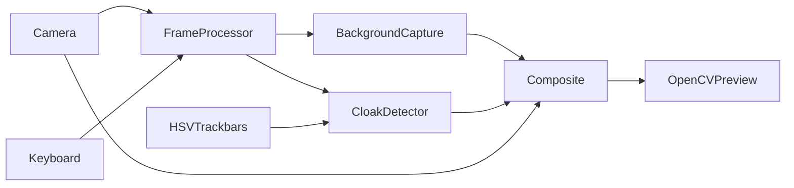

# MARAUDER AI – The Intelligent Magical Invisibility System

A Python/OpenCV prototype inspired by Harry Potter's invisibility cloak. This is
a colour-key compositing illusion: a **static camera** and a previously captured
empty scene let the program replace a coloured cloth with background pixels.
Only pixels matching the cloth colour disappear; exposed skin and other clothes
remain visible. This is not physical invisibility or AI body removal.

## Current scope: Phases 1 and 2

Implemented: webcam discovery, adjustable requested resolution, nonblocking
multi-frame median background capture, locked background and recapture,
green/red/blue HSV detection (including red hue wraparound), normalized alpha
compositing, invisibility toggle, FPS/processing-time display, HSV trackbars and
JSON calibration, camera error reporting, and automated pipeline tests.

Phase 2 adds morphological opening/closing, contour-area noise rejection,
Gaussian edge feathering and time-aware temporal smoothing. Use `--raw-mask`
to compare against the Phase 1 binary mask. Automatic camera-movement warnings
remain future work. Optical flow, footsteps, particles, gestures, speech, sound,
ghost/reveal/freeze/shield effects and the PySide6 GUI are future phases. Their
packages reserve the architecture only; they contain no fake implementations.
MediaPipe, PySide6 and audio packages are deliberately not installed before
their implementation phases.

## Installation

Use Python 3.11 or newer on a desktop machine with a webcam. Python 3.12 is the
tested interpreter in the cloud development environment.

```bash
cd MARAUDER-AI
python -m venv .venv
# Linux/macOS:
source .venv/bin/activate
# Windows PowerShell instead:
# .venv\Scripts\Activate.ps1
python -m pip install -r requirements.txt
python main.py --color green
```

Pinned runtime packages: NumPy 2.2.6 and OpenCV 4.12.0.88. Install
`opencv-python`, not its headless variant: HighGUI windows are required. Linux
desktop installations may need their distribution's OpenGL/X11 runtime packages
(for example `libgl1` and `libxcb-cursor0`). A browser-only or headless cloud
session does not supply your laptop's webcam automatically.

```bash
python main.py --camera 0 --width 640 --height 480 --background-frames 15
python main.py --calibration calibration.json
python main.py --help
```

Without `--camera`, indices 0–3 are probed until a readable device is found.
Resolution is a request to the driver; the on-screen dimensions show the actual
frames. Keep the camera securely fixed and avoid automatic exposure changes.

## Capture the background and use the cloak

1. Light the scene evenly and select a saturated cloth unlike the background.
2. Leave the camera view completely empty, including the cloth. Press **B**.
3. Stay out until the capture counter changes to **Background locked** (21
   frames by default). The per-pixel median reduces transient noise; it cannot
   reconstruct a scene obscured throughout capture.
4. Enter wearing the selected cloth. Matching pixels now show the saved scene.
5. Press **I** to compare against the original. Clear the scene and press **B**
   again after any camera movement or lighting/background change.

Capture is initiated immediately, without a countdown. Have someone press B
while you stand outside the view. Normal output is shown while recapturing;
the last background is replaced only when the new capture finishes.

## Cloak calibration

Press **1**, **2**, or **3** for green, red, or blue. Press **C** to open six HSV
trackbars and a live mask. White pixels will disappear; black pixels remain. Gray refined edges blend
partially. Colour-bound changes reset temporal history to keep tuning responsive.
Adjust H to include the cloth hue and S/V to reject pale or dark surroundings.
OpenCV hue is 0–179; saturation/value are 0–255. H low greater than H high
means a wrapped interval, useful for red. Invalid intermediate S/V ordering is
clamped internally to a valid interval. Calibration edits apply live.

Press **Q** to save `calibration.json` and close calibration. Supply
`--save-calibration PATH` to choose another output, and `--calibration PATH` to
load it next time. Closing the calibration window keeps the current values in
memory but does not save. Preset keys reset the bounds and close calibration.

## Phase 1 keyboard reference

Focus an OpenCV window before using shortcuts.

| Key | Action |
| --- | --- |
| B | Capture/recapture empty background |
| I | Toggle invisibility |
| 1 / 2 / 3 | Green / red / blue preset |
| C | Open manual HSV calibration |
| Q | Save and close calibration |
| Escape | Exit and release webcam |

Voice commands (Lumos, Nox, Invisibility, Reveal), open-palm/fist gestures, and
the G/M/S/V/T/R/H magical-mode keys are planned, **not available in Phase 1**.

## Phase 2 refinement controls

Refinement runs by default. Opening removes isolated speckles, closing repairs
small gaps, contour filtering rejects tiny regions, Gaussian feathering softens
boundaries, and a time-aware exponential filter reduces mask flicker.

```bash
python main.py --color green --cleanup-size 3 --feather-size 5 --smoothing-ms 45
python main.py --raw-mask                 # Phase 1 comparison
python main.py --smoothing-ms 0           # No temporal trailing
python main.py --min-area-ratio 0.001     # Reject regions below 0.1% frame area
```

Cleanup and feather sizes must be positive odd integers; 1 disables the
corresponding spatial operation. `--smoothing-ms` must be finite and nonnegative.
Larger values smooth more but lag movement. Area ratio must be between 0 and 1.
Area is measured using OpenCV contour area, not a count of foreground pixels.
Oversized kernels/thresholds can erase small cloak details. Colour calibration,
capture, toggling invisibility and resolution changes reset temporal history.
No new dependencies are required. Real-cloth performance and appearance still
need the manual webcam acceptance check.

## Tests

```bash
python -m pip install -r requirements-dev.txt
python -m pytest -q
```

Tests exercise HSV masks, both red hue intervals, calibration round-tripping,
invalid configuration, median capture and locking, recapture, alpha
compositing, full pipeline replacement, toggle, resolution invalidation and
camera failure/release. They use generated frames and controlled device doubles;
they do not establish physical-webcam quality or a real-device FPS target.
Refinement tests additionally cover noise rejection, hole preservation, soft
edges, temporal decay, frame-rate independence and colour-change history reset.
See [the manual acceptance guide](docs/manual_testing.md) for hardware validation.

## Architecture



See [architecture and phase notes](docs/architecture.md) for module boundaries
and the roadmap. The Apache 2.0 license remains unchanged.

## Troubleshooting and performance

- **No webcam/access denied:** check OS camera permission, USB connection and
  device index. Close other applications using the webcam. A disconnection
  exits with an error and releases resources; reconnect and restart.
- **No window/display:** run in a graphical desktop, with the GUI OpenCV package.
  A headless environment can run tests, but cannot demonstrate a physical camera.
- **No invisibility:** capture the background first and check the selected colour,
  I toggle and calibration mask. Black/dark cloth usually lacks useful saturation.
- **Holes, jagged edges or flicker:** improve lighting and cloth saturation. Refinement
  reduces noise and flicker, but cannot recover cloth pixels outside the HSV
  range. Temporal smoothing can leave a short trail during fast motion; use
  `--raw-mask` for comparison.
- **Background objects disappear:** they share the keyed colour. Change cloth,
  background or HSV bounds. There is no semantic person segmentation yet.
- **Misalignment:** keep the camera still and recapture. Movement is not
  automatically detected in this phase.
- **Low FPS:** use 640×480, improve lighting to shorten exposure, and close other
  camera software. The 25–30 FPS goal must be measured on your laptop; it is not
  guaranteed. Median calculation can briefly pause on the final capture frame;
  3–31 frames are supported and capture memory scales with frame size/count.
- **Invalid calibration file or unexpected error:** the application reports a
  traceback and nonzero exit rather than failing silently. Fix the file or omit
  `--calibration` to return to presets.

## Demo and future work

Screenshots to add after hardware testing: **[empty-scene capture]**, **[green
cloak before/after]**, **[HSV calibration mask]**. These are documentation slots,
not generated evidence. Use your OS screen recorder to record background capture,
entering the frame, I toggling and recapture. Keep the camera fixed and record
the displayed FPS. No demo recording or real-webcam validation is claimed here.

Next, after physical webcam acceptance of the core and refinement: motion-linked effects; asynchronous voice/MediaPipe interaction;
additional modes and desktop GUI; then performance profiling and demonstration.
